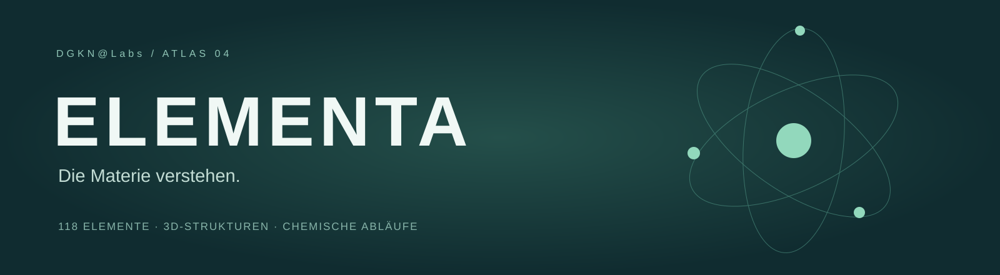
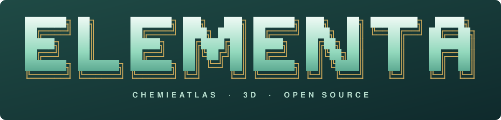
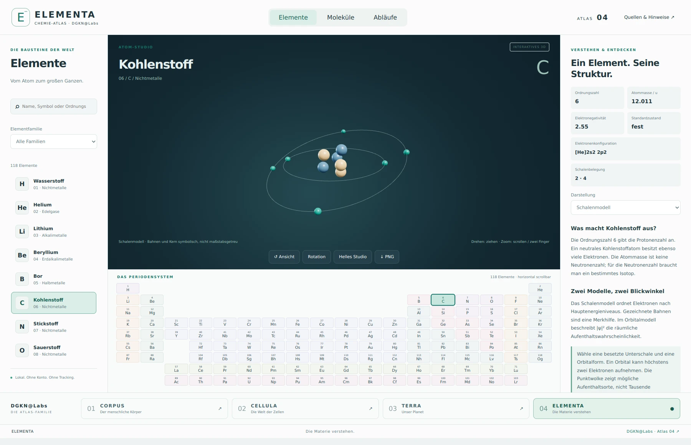
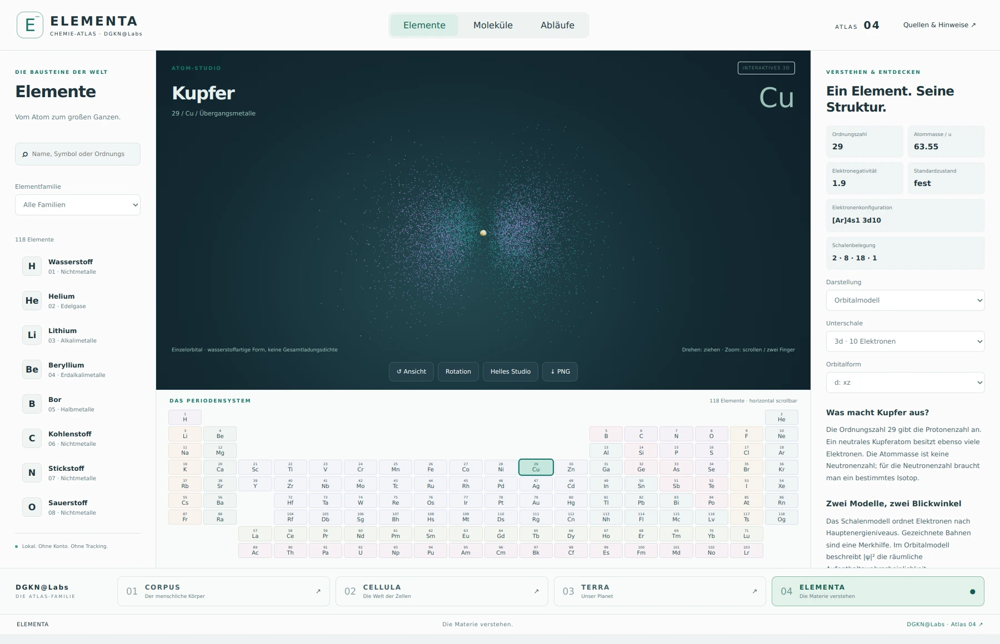
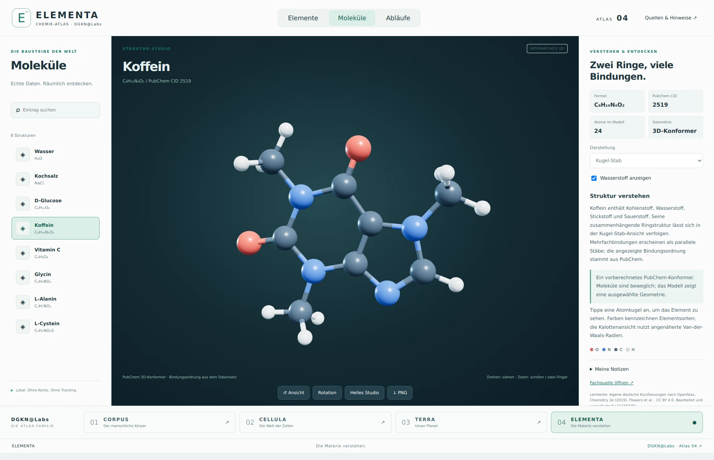
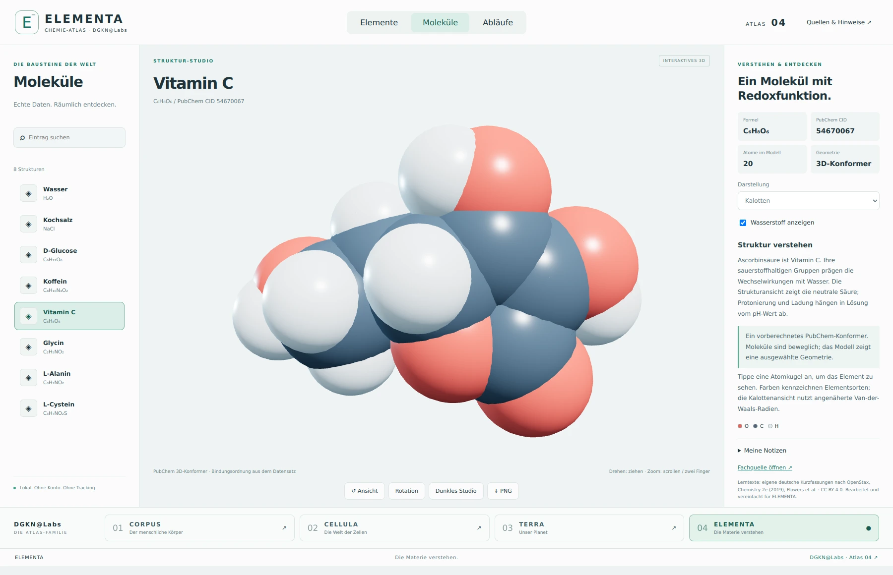
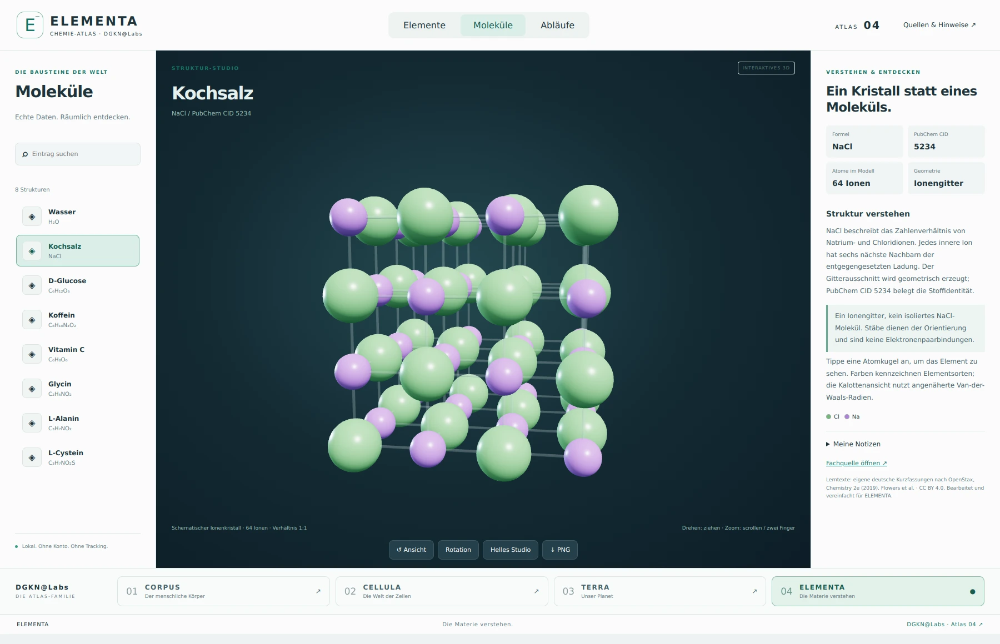
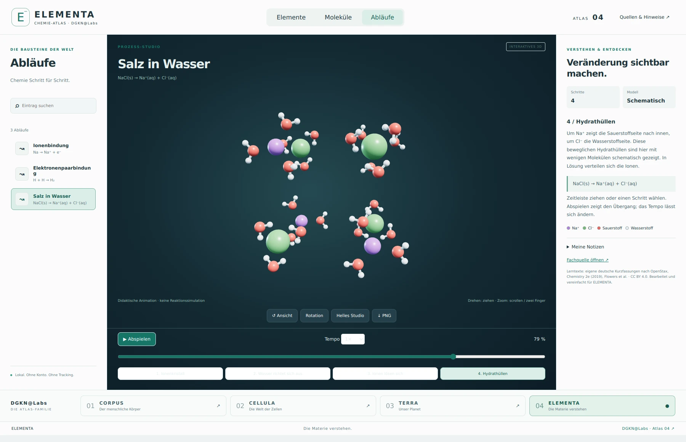
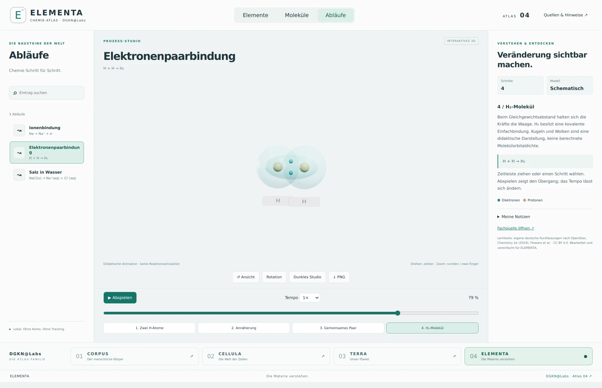
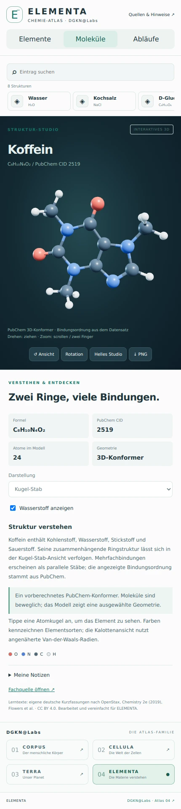

<div align="center">




<details>
<summary>Originales ASCII-Logo zum Kopieren</summary>

```text
███████╗ ██╗      ███████╗ ███╗   ███╗ ███████╗ ███╗   ██╗ ████████╗  █████╗
██╔════╝ ██║      ██╔════╝ ████╗ ████║ ██╔════╝ ████╗  ██║ ╚══██╔══╝ ██╔══██╗
█████╗   ██║      █████╗   ██╔████╔██║ █████╗   ██╔██╗ ██║    ██║    ███████║
██╔══╝   ██║      ██╔══╝   ██║╚██╔╝██║ ██╔══╝   ██║╚██╗██║    ██║    ██╔══██║
███████╗ ███████╗ ███████╗ ██║ ╚═╝ ██║ ███████╗ ██║ ╚████║    ██║    ██║  ██║
╚══════╝ ╚══════╝ ╚══════╝ ╚═╝     ╚═╝ ╚══════╝ ╚═╝  ╚═══╝    ╚═╝    ╚═╝  ╚═╝
            C H E M I E A T L A S  ·  3 D  ·  O P E N  S O U R C E
```

</details>

**Vom einzelnen Elektron bis zum Molekül des Alltags.**  
Ein interaktiver Chemie-Atlas auf Deutsch — direkt im Browser.


**[Starten](#starten) · [Entdecken](#drei-perspektiven-auf-materie) · [Screenshots](#echte-einblicke) · [Quellen](NOTICE.md)**
</div>

## Chemie wird räumlich

ELEMENTA ist der vierte Atlas von **DGKN@Labs**, nach [CORPUS](https://github.com/dogenc/CORPUS-Anatomieatlas), [CELLULA](https://github.com/dogenc/CELLULA) und [TERRA](https://github.com/dogenc/TERRA). Helle Lernpanels, ein großes 3D-Studio und eine ruhige grüne Farbwelt machen den Zusammenhang zwischen Struktur und Verhalten sichtbar.

**Kein Build. Kein API-Key. Kein Konto.** Three.js und alle verwendeten Daten liegen im Repository. Die laufende App braucht keine externe Datenverbindung; Quellenlinks führen nach außen.

## Drei Perspektiven auf Materie

| Bereich | Entdecken |
|---|---|
| **Elemente** | Vollständiges Periodensystem mit 118 Elementen, deutscher Suche und Familienfilter. Atommasse, Elektronegativität, Elektronenkonfiguration und Schalenbelegung aus PubChem. |
| **Atommodelle** | Schalenmodell und einzelne s-, p-, d- und f-Orbitale besetzter Unterschalen. Wasserstoffartige Punktwolken mit radialen und angularen Knoten; Vorzeichen der Wellenfunktion in zwei Farben. |
| **Moleküle & Kristall** | Sieben echte PubChem-3D-Konformere sowie ein separat erzeugtes Kochsalzgitter. Kugel-Stab und Kalotten, Wasserstoff ausblenden, Atome anklicken. |
| **Abläufe** | Ionenbindung, Elektronenpaarbindung am Beispiel H₂ und das Lösen von Kochsalz in Wasser. Je vier Schritte, Zeitleiste, Pause und 0,5×–2× Tempo. |

### Die Struktursammlung

| Stoff | PubChem CID | Enthaltene Ansicht |
|---|---:|---|
| Wasser | [962](https://pubchem.ncbi.nlm.nih.gov/compound/962) | 3D-Konformer, 3 Atome |
| Kochsalz | [5234](https://pubchem.ncbi.nlm.nih.gov/compound/5234) | Prozedurales Gitter, 64 Ionen |
| D-Glucose | [5793](https://pubchem.ncbi.nlm.nih.gov/compound/5793) | 3D-Konformer, 24 Atome |
| Koffein | [2519](https://pubchem.ncbi.nlm.nih.gov/compound/2519) | 3D-Konformer, 24 Atome |
| Vitamin C | [54670067](https://pubchem.ncbi.nlm.nih.gov/compound/54670067) | 3D-Konformer, 20 Atome |
| Glycin | [750](https://pubchem.ncbi.nlm.nih.gov/compound/750) | 3D-Konformer, 10 Atome |
| L-Alanin | [5950](https://pubchem.ncbi.nlm.nih.gov/compound/5950) | 3D-Konformer, 13 Atome |
| L-Cystein | [5862](https://pubchem.ncbi.nlm.nih.gov/compound/5862) | 3D-Konformer, 14 Atome |

### Werkzeuge zum Lernen

- **Drehen und zoomen** mit Maus oder Touch, Kamera zurücksetzen, automatische Rotation.
- **Helles und dunkles Studio**, bei gleichbleibend gut lesbaren Lernpanels.
- **PNG-Export** mit Titel und Quellenhinweis.
- **Notizen pro Eintrag**, ausschließlich im lokalen Browser-Speicher.
- **Direktlinks**, beispielsweise `#element/6`, `#molecule/caffeine`, `#process/dissolve`.
- **Tastatur:** Tab navigiert, Leertaste startet/pausiert einen Ablauf, R setzt die Kamera zurück. Reduzierte Bewegung wird für die Schalenanimation berücksichtigt.

## Echte Einblicke

Acht echte Aufnahmen aus ELEMENTA 1.1.0: **1800 × 1160 Pixel**, dazu eine separate Handyansicht. Dunkles Studio, helle Lernpanels und die Atlas-Navigation sind Teil der laufenden App.



| Orbitalstudio · Kupfer 3d | Koffein · PubChem |
|---|---|
|  |  |

| Vitamin C · Kalotten | Kochsalz · Ionengitter |
|---|---|
|  |  |



| Elektronenpaarbindung | Auf dem Smartphone |
|---|---|
|  |  |

[**Galerie in voller Auflösung →**](docs/gallery/)

## Starten

Voraussetzung: **Python 3** und ein moderner Browser mit WebGL2.

```bash
git clone https://github.com/dogenc/ELEMENTA.git
cd ELEMENTA
python3 start.py
```

Öffnet **http://127.0.0.1:8768**. Unter Windows: `START_WINDOWS.cmd` doppelklicken (Python muss installiert sein). Beenden mit Strg+C.

Die HTML-Datei braucht einen HTTP-Server; `file://` unterstützt das Laden der Module und JSON-Daten nicht zuverlässig.

### Auf der eigenen Domain

Den Inhalt von **`dist/`** als Website ausliefern — beispielsweise mit Cloudflare Pages oder einem eigenen Webserver.

| Einstellung | Wert |
|---|---|
| Build-Befehl | leer lassen |
| Ausgabeverzeichnis | `dist` |
| Backend / Umgebungsvariablen | keine |
| Unterverzeichnisse | unterstützt durch relative Asset-Pfade |

Die Website ist statisch. Es gibt keinen Service Worker und keine automatische Offline-Installation; ein lokaler Checkout funktioniert ohne Internetverbindung über den lokalen Server. Desktop-Pakete werden separat über GitHub Actions gebaut; die Website selbst bleibt ohne Build nutzbar.

## Desktop-Downloads

**[Windows & macOS herunterladen →](https://github.com/dogenc/ELEMENTA/releases/latest)** · [Build-Status ansehen](https://github.com/dogenc/ELEMENTA/actions/workflows/desktop.yml)

| Paket | Verwendung |
|---|---|
| `ELEMENTA-1.1.1-Windows-Setup.exe` | Installierbare Windows-App, x64 |
| `ELEMENTA-1.1.1-Windows-portable.exe` | Ohne Installation starten, x64 |
| `ELEMENTA-1.1.1-macOS.dmg` | macOS-App für Intel und Apple Silicon |
| `ELEMENTA-1.1.1-Web.zip` | Statische Dateien für die eigene Domain |
| `SHA256SUMS.txt` | Prüfsummen der Downloads |

Der Workflow veröffentlicht diese Dateien **erst nach erfolgreichen Daten-, Browser- und nativen Desktop-Prüfungen**. Bei einem noch laufenden oder fehlgeschlagenen Build stehen sie entsprechend noch nicht bereit. Windows- und macOS-Pakete sind ohne kommerzielles Herausgeberzertifikat; macOS ist nicht notarisiert. Das Betriebssystem kann deshalb Warnungen anzeigen.

Die Desktop-App benötigt weder Python noch einen lokalen Webserver. Alle Modelle und Bibliotheken werden mitgeliefert. Notizen bleiben im lokalen App-Profil. Links zu CORPUS, CELLULA, TERRA und Fachquellen öffnen den Standardbrowser.

Für Entwickler:

```bash
cd desktop
npm ci
npm start
# Auf Windows:
npm run dist:win
# Auf macOS:
npm run dist:mac
```

## Die Atlas-Familie

Die Leiste am unteren App-Rand verbindet alle fünf Projekte. Auf dem Smartphone passen sich die Reiter auf zwei Spalten an.

| Atlas | Thema |
|---|---|
| [**01 · CORPUS**](https://github.com/dogenc/CORPUS-Anatomieatlas) | Der menschliche Körper |
| [**02 · CELLULA**](https://github.com/dogenc/CELLULA) | Die Welt der Zellen |
| [**03 · TERRA**](https://github.com/dogenc/TERRA) | Unser Planet |
| **04 · ELEMENTA** | Die Materie verstehen |
| [**05 · ASTRA**](https://github.com/dogenc/ASTRA) | Das Universum verstehen |

## Technik und Bearbeitung

| Datei | Aufgabe |
|---|---|
| `dist/index.html`, `style.css` | Oberfläche und responsive Darstellung |
| `dist/app.js` | Navigation, Suche, Notizen, Lernpanels |
| `dist/studio.js` | Three.js-Modelle, Kamera, Prozesse und PNG-Export |
| `dist/chemistry.js` | Erklärtexte, Prozessschritte, Orbital-Sampling |
| `dist/data/` | PubChem-Rohantworten und aufbereitete Daten |
| `dist/vendor/` | Three.js 0.180.0 und OrbitControls, lokal |
| `scripts/prepare_data.py` | Daten aus PubChem aktualisieren |
| `tests/` | Daten-, Browser- und native Desktop-Prüfungen |
| `desktop/` | Electron-App und Installer-Konfiguration |
| `.github/workflows/desktop.yml` | Prüfungen, Paketbau und Release |

### Prüfen

```bash
node tests/data.mjs
```

Prüft alle 118 Schalenbelegungen, eindeutige Periodensystempositionen, Konfigurationsausnahmen, acht Moleküldatensätze, Orbital-Samples und Prozessdefinitionen.

Für den Browser-Test zusätzlich Playwright installieren (nur Entwicklung, kein App-Build):

```bash
npm install --no-save playwright
npx playwright install chromium
node tests/browser.cjs
```

Der Test startet den lokalen Server selbst und prüft Desktop und Mobilansicht, Moduswechsel, die acht Strukturen, Prozessschritte, persistente Notizen, Suche, PNG-Export und Quellen-Dialog. Prüfbilder landen in `test-results/`. Die README-Galerie erzeugt `node scripts/gallery.cjs`; PNG-Aufnahmen können für die Dokumentation verlustarm als WebP gespeichert werden.

## Modelle richtig lesen

Orbitale sind **keine Elektronenbahnen**. Die Atomansicht zeigt einzelne idealisierte wasserstoffartige Formen, keine vollständige quantenchemische Rechnung für ein Mehrelektronenatom. Der Kern ist symbolisch. Kochsalz ist **ein Ionenkristall**, kein isoliertes Molekül. Aminosäuren werden in den hinterlegten neutralen PubChem-Strukturen gezeigt; in Wasser kann die Protonierung anders sein.

Alle Vereinfachungen, Datenherkünfte und Lizenzen stehen in [NOTICE.md](NOTICE.md) und im Quellen-Dialog der App. Eine unabhängige fachredaktionelle Abnahme steht aus.

## Quellen und Lizenzen

- **Programm und prozedurale Modelle:** [MIT](LICENSE), DGKN@Labs.
- **Lerntexte:** eigene deutsche Bearbeitungen nach OpenStax *Chemistry 2e*, Flowers et al., 2019. Verwendet wird ein **nachweislich CC BY 4.0 lizenzierter historischer Quellstand**; Details und Lizenznachweis in [NOTICE.md](NOTICE.md).
- **Chemische Daten:** PubChem / NCBI, mit Original-CIDs und Rohantworten. Keine pauschale CC0-Behauptung für sämtliche PubChem-Inhalte.
- **Three.js:** MIT; Lizenz liegt bei.

---

<div align="center">
<br>


**Große Zusammenhänge beginnen bei kleinen Teilchen.**<br>
<sub>ELEMENTA · DGKN@Labs · Atlas 04</sub><br>
<sub>[CORPUS · Der Körper](https://github.com/dogenc/CORPUS-Anatomieatlas) &nbsp; / &nbsp; [CELLULA · Die Zelle](https://github.com/dogenc/CELLULA) &nbsp; / &nbsp; [TERRA · Die Erde](https://github.com/dogenc/TERRA) &nbsp; / &nbsp; <b>ELEMENTA · Die Materie</b> &nbsp; / &nbsp; [ASTRA · Das Universum](https://github.com/dogenc/ASTRA)</sub>

</div>
